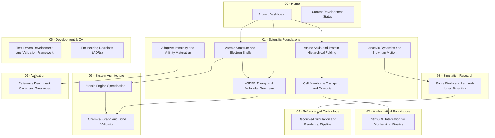

# ATOMICA — Knowledge Map

---

## Topical Navigation

### 1. Physics & Chemistry Foundations
- [[Atomic Structure and Electron Shells]] — Quantum numbers, Aufbau, Hund's rules, isotopes, and element constants.
- [[VSEPR Theory and Molecular Geometry]] — Steric numbers, electron domain geometries, and bond angles.
- [[Langevin Dynamics and Brownian Motion]] — Solvent friction, thermal noise, and symplectic Verlet integration.

### 2. Biological Systems
- [[Amino Acids and Protein Hierarchical Folding]] — Peptide bond planar constraints, Ramachandran plots, and hydrophobic collapse.
- [[Cell Membrane Transport and Osmosis]] — Lipid bilayer permeability, Fickian diffusion, and GHK resting potentials.
- [[Adaptive Immunity and Affinity Maturation]] — Clonal selection, somatic hypermutation, and antibody binding affinity.

### 3. Computation & Engineering
- [[Stiff ODE Integration for Biochemical Kinetics]] — Stiff numerical solvers (RK45 / Radau) for enzyme cascades.
- [[Force Fields and Lennard-Jones Potentials]] — 12-6 LJ potentials and harmonic spring models.
- [[Decoupled Simulation and Rendering Pipeline]] — WebAssembly workers vs. WebGPU / PixiJS render loops.
- [[Atomic Engine Specification]] — Core data contracts and validation limits.
- [[Chemical Graph and Bond Validation]] — Graph topology, kekulization, and formal charge conservation.

### 4. Standards, Testing & Governance
- [[Test-Driven Development and Validation Framework]] — TDD workflow and software verification vs. scientific validation.
- [[Reference Benchmark Cases and Tolerances]] — Ground-truth experimental datasets from NIST, IUPAC, and PDB.
- [[ADR-001 - Phase 0 Pre-Development Research Gate]]
- [[ADR-002 - GitHub as Single Source of Truth]]
- [[ADR-003 - Decoupled Compute and Render Architecture]]
