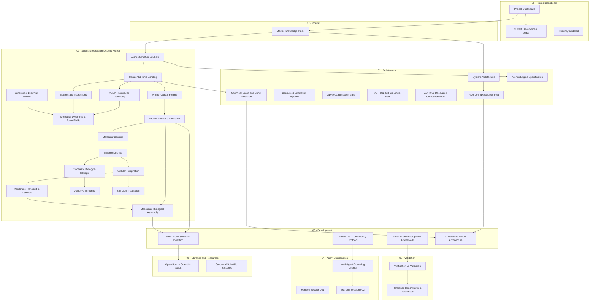

# ATOMICA — Interconnected Knowledge Map

---

## Topical Knowledge Clusters

### 1. Atomic to Molecular Geometry
- [[Atomic Structure and Electron Shells]] $\to$ [[Covalent and Ionic Bonding]] $\to$ [[VSEPR Theory and Molecular Geometry]]
- Implemented in: `src/chemistry/elements.ts`, `src/chemistry/ChemicalGraph.ts`, `src/chemistry/VseprSolver.ts`.

### 2. Classical Molecular Physics & Kinetics
- [[Electrostatic Interactions]] + [[Molecular Dynamics and Force Fields]] + [[Langevin Dynamics and Brownian Motion]]
- Implemented in: `src/simulation/Electrostatics.ts`, `src/simulation/`.

### 3. Structural Biology & Mesoscale Assembly
- [[Protein Structure Prediction]] $\to$ [[Amino Acids and Protein Hierarchical Folding]] $\to$ [[Molecular Docking]] $\to$ [[Mesoscale Modeling and Biological Assembly]]
- Ingested via: `src/proteins/PdbClient.ts`, packed via `src/mesoscale/CellPackAssembler.ts`.

### 4. Biochemical Kinetics & Cellular Physiology
- [[Enzyme Kinetics]] $\to$ [[Cellular Respiration]] $\to$ [[Cell Membrane Transport and Osmosis]] $\to$ [[Stochastic Biology and Gillespie Kinetics]]
- Modeled via: `src/simulation/GillespieSimulator.ts`, `src/simulation/CellularRespiration.ts`.

### 5. Multi-Agent Governance & Concurrency
- [[Fallen Leaf Multi-Agent Concurrency Protocol]] $\to$ [[Multi-Agent Operating Charter]] $\to$ [[Project Dashboard]]
- Enforced via: `scripts/coordinator.py`, `project-management/task-system/locks.json`.
