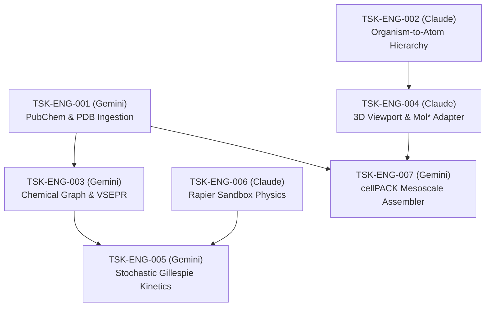

# ATOMICA: Task Dependency Graph

---

## Parallel Execution Plan
1. **Track A (Gemini):**
   - Owns `src/chemistry/` and `src/proteins/` (`TSK-ENG-001`).
   - Fetches and parses real molecular datasets (Creatine, Glucose, Spike protein).
2. **Track B (Claude):**
   - Owns `src/anatomy/` and `src/visualization/` (`TSK-ENG-002`, `TSK-ENG-004`).
   - Builds the zoom navigation tree and Three.js / Mol* viewport.
3. **Zero Concurrency Overlap:**
   - Neither agent touches the other's directories or files.
   - Integration occurs through documented schemas in `project-management/API_CONTRACTS.md`.
